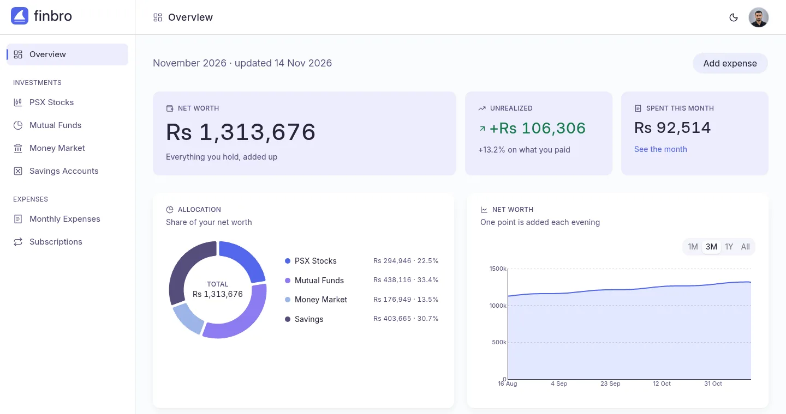
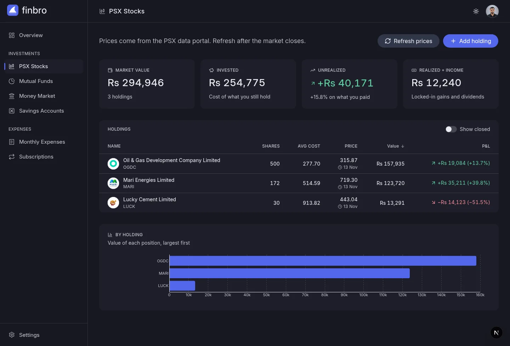
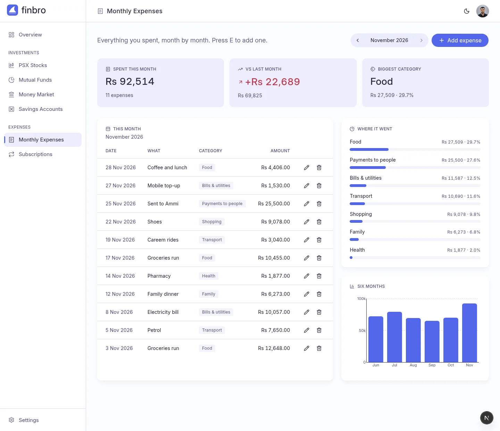
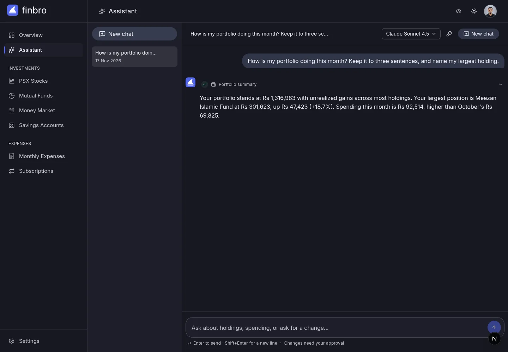
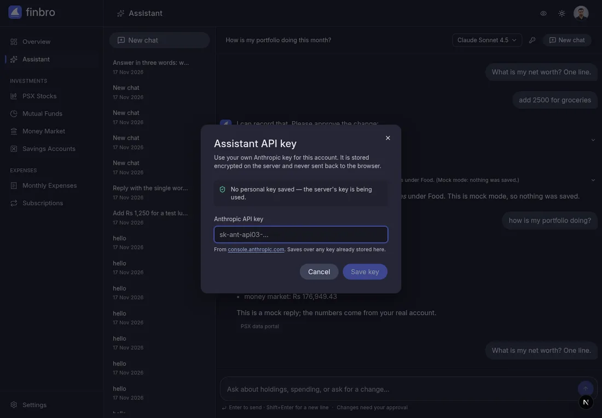

<p align="center">
  <picture>
    <source media="(prefers-color-scheme: dark)" srcset="public/logo-dark.svg">
    
  </picture>
</p>

<p align="center">
  <strong>Your portfolio and your month, in one quiet dashboard.</strong><br>
  PSX stocks · mutual funds · money market · savings accounts · monthly spending · subscriptions
</p>

<p align="center">
  <a href="#running-it">Running it</a> ·
  <a href="#how-prices-work">How prices work</a> ·
  <a href="#deploying">Deploying</a> ·
  <a href="plan/fin-bro/README.md">The plan</a>
</p>

<p align="center">
  
  
  
  
  
  
  
  
  
</p>

---

<p align="center">
  <picture>
    <source media="(prefers-color-scheme: dark)" srcset="docs/screenshots/overview-dark.webp">
    
  </picture>
</p>

## Why this exists

Most portfolio trackers are built for US brokerages. This one is built around how
investing actually looks in Pakistan: PSX settlements, MUFAP fund NAVs that move
once a day, and a savings account that pays profit instead of interest. It tracks
what you own and what you spend, and stops there — no advice, no predictions, no
feed of other people's returns.

The look follows [Mercury's design language](design-reference.md): two surface
worlds, one indigo action per view, light type, and numbers that line up.

## What it does

| Area | What you get |
| --- | --- |
| **Overview** | Net worth, unrealized gain, allocation donut, net-worth history, a stacked "value by kind" chart, what is due in the next 30 days, top holdings, and a privacy eye that masks every amount |
| **PSX stocks** | Search every listed equity and ETF by company name or symbol, add holdings, buy/sell/bonus/dividend transactions, average-cost P&L (realized and unrealized), company logos, per-holding value chart |
| **Mutual funds & money market** | Fund search over 573 MUFAP funds with the AMC's mark, 4-decimal NAVs, invest by amount or by units, reinvested dividends as bonus units |
| **Savings accounts** | Balance, net deposited and profit earned, deposits and withdrawals, one-tap reconciliation against your bank app |
| **Monthly expenses** | `E` opens the add-expense popup anywhere, month switcher in the URL, category breakdown, six-month trend |
| **Subscriptions** | Monthly or yearly, monthly cost, overdue flags, "Mark paid" records the expense and advances the due date, with Undo |
| **Assistant** | Ask about anything in the account, search the web for market news, and make changes through an approval card. Every conversation is saved |
| **Settings** | Light/dark/system theme, category management with usage counts, password change |

<details>
<summary><strong>More screens</strong></summary>

<p align="center">
  
  
</p>

<p align="center">
  
</p>

<p align="center">
  
</p>

</details>

## The assistant

A chat that has read access to the whole account and can change it with your approval.

- **Reads** — net worth, every holding with units, average cost and P&L, transactions, monthly spending and categories, subscriptions, plus live PSX quotes. Every number in an answer comes from a tool call, never from the model's memory.
- **Writes** — add or delete an expense, record a buy/sell/dividend/deposit/profit, add a holding or savings account, set a price by hand, add a subscription, mark one paid. Each one stops at an approval card showing exactly what will change; nothing runs until you press Approve.
- **Web search** — Gemini's Google Search grounding, used for news, rates and anything after the model's cutoff. Sources render under the answer.
- **History** — threads and messages are stored in Postgres per user, titled from the first message, renameable and deletable.

**Claude only, by design.** The chat runs on Anthropic. A dropdown in the header picks the model — Haiku 4.5 (fastest), Sonnet 4.5 (default), Sonnet 5, Opus 4.5 (most capable) — and the choice is saved per account.

**Bring your own key.** The key icon in the header opens a small dialog: paste an Anthropic key and it is encrypted (AES-256-GCM, keyed from the app secret) before it touches the database, and only ever shown back as `••••••1234`. Remove it at any time and the server's `ANTHROPIC_API_KEY` takes over. Settings → Assistant has the same controls. Every failure (credit, rate limit, rejected key, overload) is a sentence with a Retry button, not a stack trace.

`ASSISTANT_MOCK=true` (development only) streams scripted replies — including a full approval round-trip — without calling Anthropic. It is ignored in production.

## Stack

| Layer | Choice | Why |
| --- | --- | --- |
| Framework | Next.js 16 (App Router), React 19, TypeScript | Server components for the shell, client components for tables and dialogs |
| API | tRPC v11 + TanStack Query | End-to-end types, no hand-written fetch layer |
| Database | PostgreSQL (Neon) + Drizzle ORM | Exact `numeric` money columns, SQL-first schema |
| Auth | Better Auth, email + password | Runs inside the app; sign-up disabled; one owner account |
| UI | Tailwind CSS v4 + shadcn/ui, Mercury tokens | Two themes from one set of CSS variables |
| Charts | MUI X Charts | Themed through a small MUI bridge; no MUI reset |
| Forms | react-hook-form + Zod | One schema validates the form and the API input |
| Prices | PSX data portal, MUFAP dataset | See below |

## Running it

```bash
pnpm install
cp .env.example .env        # fill in the values below
pnpm db:migrate             # create the tables
pnpm user:create            # create your account (no sign-up page exists)
pnpm dev                    # http://localhost:3000
```

Node 22+ and pnpm 10+ are expected; the repo was built on Node 26 and pnpm 12.

### Environment

| Name | Purpose |
| --- | --- |
| `DATABASE_URL` | Postgres connection string (Neon's pooled URL in production) |
| `BETTER_AUTH_SECRET` | Session signing secret — `openssl rand -base64 32` |
| `BETTER_AUTH_URL` | `http://localhost:3000` locally, `https://fin.devshub.xyz` in production |
| `CRON_SECRET` | Guards `/api/cron/daily`; Vercel sends it automatically |
| `AUTH_ALLOW_SIGNUP` | Set to `true` only while `pnpm user:create` runs |
| `ANTHROPIC_API_KEY` | Server key, used when the account has no key of its own |
| `ANTHROPIC_MODEL` | Default model when the account has not chosen one, `claude-sonnet-4-5` |
| `ASSISTANT_MOCK` | `true` in development to stream scripted replies instead of calling Gemini |

### Commands

| Command | What it does |
| --- | --- |
| `pnpm dev` | Development server |
| `pnpm build` | Production build |
| `pnpm check` | Lint + typecheck |
| `pnpm test` | Unit tests for the money maths and date helpers |
| `pnpm db:generate` | Write a migration from `src/server/db/schema.ts` |
| `pnpm db:migrate` | Apply migrations |
| `pnpm db:studio` | Browse the database |
| `pnpm user:create` | Create the owner account |
| `pnpm user:delete <email>` | Delete an account and everything it owns |
| `pnpm seed:demo <email>` | Fill an account with demo data (wipes its data first) |
| `pnpm psx:sync` | Refresh the bundled PSX company directory |
| `pnpm rate-limit:clear` | Reset sign-in rate-limit counters |

## How prices work

There is no official PSX API. Everything is read from the public data portal and
one open dataset, with the stored price kept when a source fails.

| Data | Source | Cadence |
| --- | --- | --- |
| Stock quotes | `dps.psx.com.pk/company/{SYMBOL}` (HTML), falling back to `/timeseries/int/{SYMBOL}` | Daily job + first visit to an investments page + the Refresh button; cached 5 minutes |
| Company directory | Bundled JSON of 617 symbols — every equity and ETF on the Exchange's own listing, names enriched from a CC0 dataset | `pnpm psx:sync` (`--all` also names the long tail) |
| Company logos | The company's own website, read from its PSX page, or the bank/AMC behind a fund from a committed map → Google favicon cache → DuckDuckGo → the site's `favicon.ico` | Cached a week (memory + HTTP) |
| Fund NAVs | [Pakistan mutual funds dataset](https://github.com/saadsalmankhan/pakistan-mutual-funds-data) (MUFAP scrape, 4 decimals) | Daily job, cached 12 hours |

The daily job (`/api/cron/daily`, Vercel cron `0 18 * * *` UTC — late evening in
Pakistan, after the close and after the NAV publish) refreshes prices, records
one net-worth snapshot per asset kind, and is safe to run twice.

Neither PSX nor the fund dataset is a licensed feed. Both are used here for
private, low-volume personal tracking and can change without notice; a manual
price can always be entered from a holding's sheet.

## Data model in one paragraph

An `asset` is a holding or an account (`stock`, `mutual_fund`, `money_market`,
`savings`). An `asset_txn` is any movement in it — buy, sell, bonus, dividend,
deposit, withdrawal, profit — and positions are derived, never stored: units,
average cost, realized and unrealized gain come from a pure function that is
unit-tested. Expenses reference a category and optionally the subscription that
created them. `portfolio_snapshot` holds one row per day per asset kind for the
history charts. Everything is scoped to the signed-in user.

## Project layout

```
src/app/            routes: (app) shell pages, (auth) login, api/auth, api/cron, api/logo
src/components/     ui (shadcn, themed), shell (sidebar, top bar), shared, charts
src/features/       investments, savings, expenses, subscriptions, overview, assistant, settings
src/lib/            portfolio maths, dates, formatting, schemas, categories
src/server/         db, better-auth, tRPC routers, assistant (context, tools, prompt), price sources, daily job
scripts/            create-user, seed-demo, sync-psx-symbols, rate-limit
docs/screenshots/   README images
plan/fin-bro/       the research, design system, architecture and phases this was built from
```

## Deploying

1. Push to GitHub, import the repository in Vercel.
2. Add the environment variables above, with `BETTER_AUTH_URL` set to your domain.
3. Point the domain at Vercel and wait for the certificate.
4. Run `pnpm db:migrate` once against the production database.
5. Create your account with `pnpm user:create`.
6. Confirm the sign-up endpoint answers `EMAIL_PASSWORD_SIGN_UP_DISABLED`, and
   that `/api/cron/daily` returns 401 without the secret.

Backups: `pg_dump "$DATABASE_URL" > finbro-$(date +%F).sql`, now and then.

## Installable

finbro is a PWA: open it on your phone and use **Add to Home Screen** (iOS Safari:
Share → Add to Home Screen; Android Chrome: menu → Install app). It opens
full-screen with the app icon, remembers the last screen you visited, and shows
an offline page when the network drops. The manifest, icons and service worker
all ship in this repo (`app/manifest.ts`, `public/icons`, `public/sw.js`).

## Notes

- The app opens in **dark mode** by default; light and system are one click away.
- The eye next to net worth (and in the top bar) hides every amount, percentage and chart behind `••••••`, for screenshots or a shared screen. The choice sticks per browser.
- The fonts are Inter (variable) at weights 360/420/480 — Mercury's arcadia
  substitute, and the reason nothing on screen is bold.
- The demo account used for the screenshots is `dev-tester@finbro.local`; delete
  it before making the app reachable with `pnpm user:delete`.
- Company logos are trademarks of their owners, shown only to identify a holding.

## License

Personal project. The code is not licensed for redistribution; the design
language it follows belongs to [Mercury](https://mercury.com), and the PSX and
MUFAP data belongs to its publishers.
